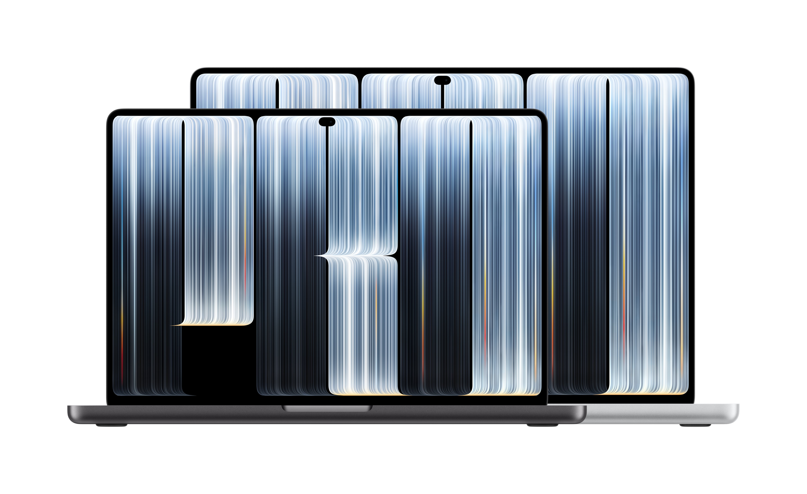
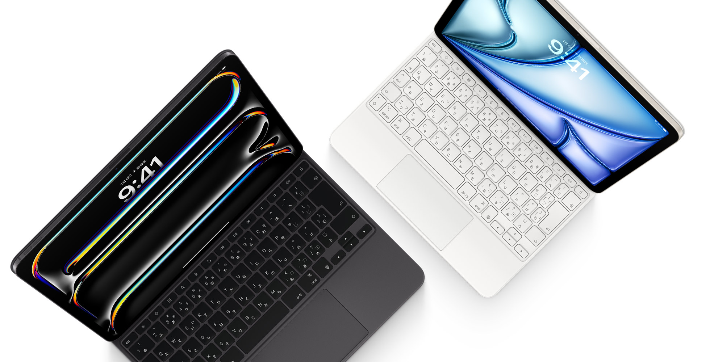
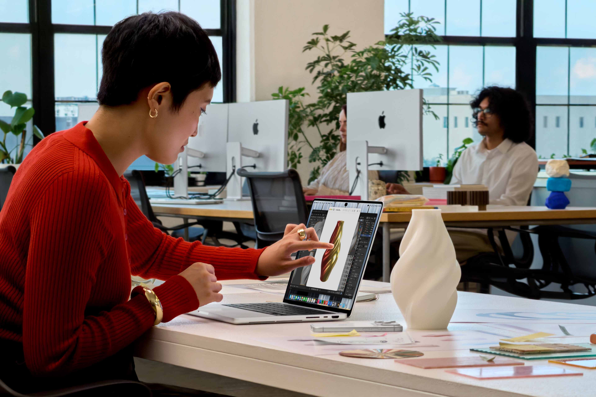

2026年10月28日、Appleは「MacBook Pro with PROLED XDR Display」を発表した。タンデムOLEDディスプレイやDynamic Islandの採用など変更点は多いが、中でも注目したいのが、Macとして初めてディスプレイへのタッチ操作に対応したことだ。

*MacBook Pro with PROLED XDR Display*

Appleはこれまで、Macへのタッチスクリーン搭載に否定的な姿勢を示してきた。そのため今回の発表を受け、スティーブ・ジョブズの過去の発言と矛盾しているという批判も見かける。

僕自身、これまでMacBookのタッチ対応には反対だった。MacBookまでタッチ操作に対応すると、iPadとの棲み分けが分かりにくくなると思っていたからだ。しかし今回の発表を見て、その考えが変わった。MacBookの基本的な操作方法はそのままに、タッチが補助的な操作として加わっている。これなら、むしろ歓迎したい。

一方、過去のAppleの発言を理由にした批判には、少し疑問もある。iPadだってMagic Keyboardを取り付ければ画面を立てて使う。それでも画面へのタッチ操作は残っている。MacBookだと、なぜそれが問題になるのだろうか。

## 手を上げて操作するのは快適ではない

2010年10月20日、スティーブ・ジョブズは「Back to the Mac」の発表イベントで、ノートPCのタッチスクリーンに否定的な見解を示した。Appleでも実際にタッチ対応のノートPCを試していたが、垂直に近い画面を操作し続けると腕が疲れてしまう。ノートPCのディスプレイはタッチ操作に適していないという判断だった。

この指摘は今でも理解できる。MacBookで文章を書いたり、ファイルを操作したりするたびに画面へ手を伸ばしていたら、確かに疲れるだろう。MacBookには優れたトラックパッドがあり、キーボードから手を大きく動かさなくても多くの操作ができる。長時間の作業では、こちらの方が合理的だと思う。

ただ、タッチ操作に対応したからといって、すべての操作を画面に触れて行う必要はない。普段はトラックパッドを使い、直接触れたいときだけ画面に手を伸ばせばいい。ジョブズが指摘した腕の疲労という問題は現在でも残っているが、それだけでタッチ操作を追加する意味がなくなるとは思わない。

## iPadとMagic Keyboardはどうなのか

ここで考えたいのが、iPadのMagic Keyboardだ。2020年に登場したiPad Pro用のMagic Keyboardは、iPadをノートPCのように立てて使えるアクセサリで、キーボードとトラックパッドを備えている。

*iPadとMagic Keyboard*

こうして見ると、MacBookとかなり似た姿をしている。この状態でiPadの画面に触れるには、キーボードから手を離して腕を伸ばす必要がある。垂直に近い画面へのタッチ操作が疲れるのであれば、Magic Keyboardを取り付けたiPadでも同じ問題が起きるはずだ。

もちろん、iPadとMacBookではもともとの設計が異なる。iPadOSはタッチ操作を中心に設計されており、ボタンの大きさやジェスチャーも指での操作を考慮している。一方、macOSはマウスやトラックパッドを中心に発展してきた。また、iPadはMagic Keyboardから取り外して手に持つこともできるため、まったく同じ条件では比較できない。

それでも、画面を立てた状態で手を伸ばすという動作は似ている。そしてAppleは、iPadにトラックパッドを追加する際、タッチ操作をなくさなかった。長時間の作業や細かな操作にはトラックパッドを使い、直接触れたいときにはタッチ操作を使える。Magic Keyboardがあるからといって、タッチが不要になったわけではない。

画面を立てて使うことと、画面に直接触れることは、すでにiPadで両立している。MacBookでも同じように操作方法を選べるようになっていいのではないだろうか。

## MacBookの操作体験はどう変わるのか

ここで気になるのが、macOSのUIだ。macOSはポインタによる操作を前提に設計されてきたため、小さなボタンやメニュー項目など、指では扱いにくい部分がある。

今回のMacBook Proでは、こうした問題にも対応している。画面を指で操作すると、メニュー項目の間隔が広がり、ウインドウの操作ボタンも大きくなる。普段はこれまでのMacと同じUIを使いながら、タッチ操作をするときには指で扱いやすい表示に変わる。既存アプリでタッチをクリックとして扱う仕組みや、開発者がタッチ向けの操作を実装するためのAPIも用意されている。

この設計は、僕が以前から懸念していたiPadとの棲み分けを考えるうえでも興味深い。

もしmacOSがタッチ操作を中心としたUIに変わるのであれば、MacBookとiPadの違いは分かりにくくなるだろう。しかし今回のタッチ対応では、従来のMacの使い方を維持しながら、必要な場面でタッチ操作を利用できるようになっている。MacBookの操作をタッチ中心に変更するのではなく、従来の操作を補う形で追加されていることを評価している。

実際、MacBookには以前からMulti-Touchジェスチャーに対応したトラックパッドがある。スクロールやピンチによる拡大など、画面に触れなくても多くの操作を行える。それでも、操作したいものに直接触れられることには、トラックパッドとは違った使いやすさがある。

例えば、アプリ開発での使い方だ。これまではMac上のシミュレーターで、マウスやトラックパッドを使ってiPhoneやiPadへのタッチ操作を再現してきた。今回Appleは、MacBook Proの画面に直接触れながら、iOSやiPadOSアプリの操作を試せると紹介している。

実際のiPhoneやiPadとは画面の大きさも持ち方も違うが、開発中に指で触れて操作を確かめられれば、より実際の利用に近い感覚で開発を進められる。マウスやトラックパッドによる操作に加えて、タッチでも確認できるようになったことは、開発者にとっても便利だと思う。

また、iPhoneやiPadで日常的にタッチ操作をしていると、MacBookの画面にもそのまま手を伸ばしたくなる場面がある。これまでは反応しなかった画面に直接触れて操作できるようになるのは、単純だが使いやすさにつながる変化だ。

長時間の文章編集や細かな位置の指定では、これまで通りトラックパッドやキーボードを使えばいい。画面上のものに直接触れたいときには、タッチを使える。作業に合わせて操作方法を選べることが、今回のMacBook Proの利点だと感じている。

*MacBook Pro with PROLED XDR Displayでのアプリ開発*

## 「触りたい」に応えられるMacBookへ

Appleが長年の方針を変えたことは事実だし、ジョブズが指摘した腕の疲労という問題も残っている。しかし、長時間のタッチ操作が快適ではないことと、MacBookにタッチスクリーンを搭載する意味があるかどうかは、同じ話ではない。

iPadはタッチ操作を中心とした製品に、Magic Keyboardによってトラックパッドという操作方法を追加した。そして今回のMacBook Proでは、トラックパッドを中心とした製品にタッチ操作が加わった。両者の操作方法は似てきたが、それぞれの中心となる操作体験は変わっていない。

さらにAppleは、タッチ対応のMacBook Pro with PROLED XDR Displayだけでなく、従来のLiquid Retina XDRディスプレイを搭載したタッチ非対応のMacBook Proも引き続き販売している。タッチ操作を使いたい人は新しいモデルを、これまでの使い方で十分な人は従来のモデルを選べる。操作方法だけでなく、製品のラインアップにも選択肢が残されている。

僕はこれまで、iPadとMacBookの役割が曖昧になることを理由に、MacBookのタッチ対応には否定的だった。しかし今回の発表を見て、MacBookの使い方を変えずにタッチ操作を追加するのであれば、むしろ歓迎したいと感じた。

「手を上げて行うマルチタッチは快適ではない」という指摘が、そのまま「MacBookにタッチは不要」という結論になるとは思わない。

これまでMacBookにタッチスクリーンがなくても、大きく困ることはなかった。それでも、画面に直接触れたいと思う場面はある。今回のタッチ対応によって、そうした「触りたい」というニーズに応えられるようになった。

以前は不要だと思っていたMacBookのタッチ対応を、今は前向きに評価している。

## 参考

- [MacBook Pro with PROLED XDR Display](https://www.apple.com/macbook-pro/proled-xdr-display/) - Apple公式ページ
- [Apple unveils groundbreaking MacBook Pro with PROLED XDR Display](https://www.apple.com/newsroom/2026/10/apple-unveils-groundbreaking-macbook-pro-with-proled-xdr-display/) - Apple Newsroom
- [MacBook Pro with Liquid Retina XDR Display](https://www.apple.com/jp/macbook-pro/liquid-retina-xdr-display/) - Apple公式ページ
- [Apple、iPad ProとMagic Keyboardを発表](https://www.apple.com/jp/newsroom/2020/03/apple-unveils-new-ipad-pro-with-lidar-scanner-and-trackpad-support-in-ipados/) - Apple Newsroom
- [ジョブズ氏が語る、タッチスクリーンMacBookを出さない理由](https://www.itmedia.co.jp/news/article/1010/21/1101021070/) - ITmedia NEWS
- [How macOS Adapts Its Controls for Touch on the New MacBook Pro](https://www.macrumors.com/2026/10/29/macos-adapts-controls-touch-macbook-pro/) - MacRumors
